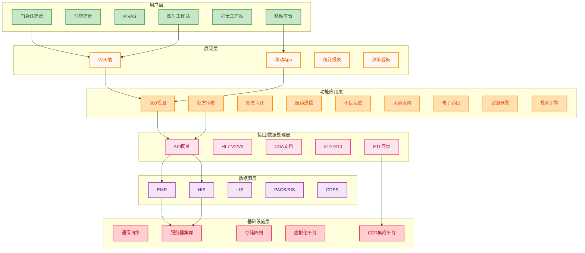

# 医院信息化建设项目文档生成技能

## 概述

本技能用于生成医院信息化建设项目的全套文档。用户输入项目名称或需求资料后，技能自动完成政策检索、需求整理、文档生成全流程，输出11类标准化项目文档。

## 触发条件

当用户提到以下关键词时触发本技能：
- 医院信息化建设、医院系统建设、医疗信息化项目
- 项目立项申报、项目需求调研、项目可行性分析
- 招标采购文件、采购评分标准、项目采购合同
- 项目验收、系统开发文档、需求详细说明书
- 项目实施计划、甘特图、项目费用明细

## 工作流程

整个流程分为5个阶段，必须按顺序执行：

### 阶段一：需求信息收集

1. 接收用户输入的项目名称或需求资料
2. 检查用户是否上传了参考材料：
   - 表格/图表（作为系统数据模型参考）
   - 工作流程图（作为系统功能规则参考）
   - 制度文件（作为系统功能规则参考）
3. 如果用户提供了材料，使用 Python（python-docx/openpyxl/pdfplumber）解析提取结构化信息
4. 如果用户未提供需求资料，进入阶段二自动检索

### 阶段二：政策标准检索（无需求资料时执行）

**检索总原则**：优先检索国家级行政机关发布的政策、法律法规、标准，再检索地方配套文件。详细检索策略参见 `references/policy_standards.md`。

#### 第一步：国家级行政机关政策检索（按优先级顺序执行）

按以下优先级顺序检索，覆盖八大主管机关的本领域政策：

| 优先级 | 国家机关 | 官网 | 政策域 | 关键词模板 |
|--------|----------|------|--------|------------|
| 1 | 国家医保局 | nhsa.gov.cn | 医保信息化、医保支付方式改革、医保编码标准 | `国家医保局 信息化 标准 接口` |
| 2 | 国家卫健委 | nhc.gov.cn | 卫健信息标准、智慧医院建设、公立医院考核、电子病历、互联互通 | `国家卫健委 智慧医院 评估标准` |
| 3 | 国家药监局 | nmpa.gov.cn | 药监管理政策、药品信息化追溯、器械信息化 | `国家药监局 药品信息化 追溯` |
| 4 | 国家中医药管理局 | natcm.gov.cn | 中医药信息化、中医电子病历 | `国家中医药管理局 信息化` |
| 5 | 国家疾控局 | ndcpma.gov.cn | 疾控信息化、公共卫生信息化 | `国家疾控局 信息化` |
| 6 | 公安部 | mps.gov.cn | 信息安全等级保护 | `公安部 等级保护 2.0 医疗卫生` |
| 7 | 国家网信办 | cac.gov.cn | 网络安全法、数据安全法 | `国家网信办 数据安全 医疗卫生` |
| 8 | 国家标准化管理委员会 | sac.gov.cn | 国家标准(GB) | `国家标准委 医疗卫生 信息化 GB` |

**检索要求**：
- 检索时间范围：近5年（重点2019-2026年）
- 对每个主管机关，使用 web_search 检索其官网的最新政策文件
- 对检索到的政策文件，记录：文件名称、发文单位、文号、发布日期、官方链接、核心内容摘要

#### 第二步：法律法规检索

检索与项目相关的国家法律、行政法规、部门规章：

| 类别 | 文件举例 | 对医院信息化的要求 |
|------|----------|----------------------|
| 国家法律 | 《网络安全法》《数据安全法》《个人信息保护法》《基本医疗卫生与健康促进法》 | 网络运营安全、数据保护、等级保护 |
| 行政法规 | 《医疗卫生机构网络安全管理办法》《互联网诊疗管理办法》《互联网医院管理办法》 | 医疗卫生机构网络安全管理、互联网诊疗要求 |
| 部门规章 | 《电子病历应用管理规范》《处方管理办法》《药品信息化追溯体系建设指导意见》 | 电子病历管理、处方管理、药品追溯要求 |

#### 第三步：国家标准/行业标准/团体标准检索

检索与项目相关的标准文件（详细标准清单参见 `references/policy_standards.md` 第七章）：

| 标准类型 | 标准编号示例 | 检索关键词 |
|----------|-------------|------------|
| 国家标准(GB/T) | GB/T 22239-2019、GB/T 41831-2022 | `GB/T 医院信息化 标准` |
| 行业标准(WS/T) | WS/T 445-2014、WS/T 826-2023 | `WS/T 卫健委 信息化 标准` |
| 团体标准(T/XXX) | T/CHAS、T/CNAS | `T/CHAS 医院协会 信息化` |

**重点标准**（必须检索）：
- WS/T 826-2023《医院信息化建设标准与规范》
- WS/T 445-2014《电子病历基本数据集》
- WS/T 500-2016《电子健康档案与区域卫生信息平台标准》
- GB/T 22239-2019《信息安全技术 网络安全等级保护基本要求》

#### 第四步：政府采购招标文件检索

检索同类项目招标信息，提取参考指标：

| 检索来源 | URL | 覆盖内容 |
|----------|-----|----------|
| 中国政府采购网 | ccgp.gov.cn | 全国性政府采购项目 |
| 各省政府采购网 | {省份}.ccgp.gov.cn | 省级政府采购项目 |
| 各市公共资源交易中心 | 各市公共资源交易网 | 市级采购项目 |

**提取要点**：功能需求清单、预算金额范围、资格要求、评分标准、合同条款、实施周期。

#### 第五步：政策分析整合

将检索到的政策文件交由 `@skill://何药师政策分析` 处理，输出：
- 政策要点摘要（按主题分类的政策要求清单）
- 合规性要求清单（项目需满足的硬性要求）
- 建设标准要求（技术标准、数据标准、安全标准）
- 数据安全与隐私保护要求
- 评审/考核指标要求（公立医院考核、智慧医院评估等）
- 政策趋势分析

#### 第六步：需求整理

基于检索结果，整理项目的：
- 数据模型（实体关系、字段定义、数据字典）
- 指标体系（统计维度、计算公式、展示方式）
- 功能规则（业务逻辑、校验规则、权限规则）
- 业务流程逻辑（主流程、分支流程、异常处理）

### 阶段三：功能需求整理

基于阶段一和阶段二收集的信息，整理完整的功能需求：

1. **数据模型梳理**
   - 核心实体识别与定义
   - 实体关系图（ER图）设计
   - 数据字典编制（字段名、类型、长度、约束、说明）
   - 数据存储方案

2. **指标体系设计**
   - 统计指标定义（名称、计算公式、数据来源、更新频率）
   - 指标分类体系（基础指标、复合指标、分析指标）
   - 指标展示方式（表格、图表、仪表盘）

3. **功能规则梳理**
   - 业务规则（数据校验、流程控制、状态转换）
   - 权限规则（角色定义、权限矩阵、数据隔离）
   - 接口规则（对接系统、数据交换、协议标准）

4. **业务流程逻辑设计**
   - 主业务流程（流程图描述）
   - 分支流程与异常处理
   - 流程节点定义（输入、处理、输出、角色）

### 阶段四：文档生成

按以下顺序生成11类项目文档。所有文档保存到用户指定目录或当前工作目录下的 `项目文档输出/` 文件夹。

#### 文档清单与生成顺序

| 序号 | 文档名称 | 格式 | 生成方式 | 模板参考 |
|------|----------|------|----------|----------|
| 1 | 项目立项申报书 | DOC | python-docx生成 | references/doc_templates.md §1 |
| 2 | 项目需求调研表 | EXCEL | openpyxl生成 | references/doc_templates.md §2 |
| 3 | 项目费用明细表 | EXCEL | openpyxl生成 | references/doc_templates.md §3 |
| 4 | 项目可行性分析报告 | DOC | python-docx生成 | references/doc_templates.md §4 |
| 5 | 项目招标采购文件 | DOC | python-docx生成 | references/doc_templates.md §5 |
| 6 | 项目招标采购评分标准 | EXCEL | openpyxl生成 | references/doc_templates.md §6 |
| 7 | 项目采购合同 | DOC | python-docx生成 | references/doc_templates.md §7 |
| 8 | 项目实施甘特图 | EXCEL | scripts/gen_gantt.py | references/doc_templates.md §8 |
| 9 | 系统开发文档 | DOC+HTML | python-docx生成 | references/doc_templates.md §9 |
| 10 | 需求详细说明书 | DOC | python-docx生成 | references/doc_templates.md §10 |
| 11 | 项目验收报表 | EXCEL+DOC | openpyxl+python-docx | references/doc_templates.md §11 |

#### 生成规则

1. **项目立项申报书**（含系统框架图）：
   - 使用 python-docx 生成 .docx 文件
   - 系统框架图按本文件"## 系统架构图生成规范"章节执行：先调用 `@skill://architecture-designer` 设计，生成 `.mmd` 源码 + 渲染HTML双输出，再截图嵌入文档
   - 内容结构参考 references/doc_templates.md §1
   - 参考示例：申报书包含项目简介、建设背景（政策/行业/医院现状）、建设必要性、建设可行性、建设目标、建设内容、实施计划、投资预算、效益分析、保障措施、项目总结

2. **项目需求调研表**（EXCEL）：
   - 使用 openpyxl 生成 .xlsx 文件
   - 包含多个Sheet：功能需求调研、数据需求调研、接口需求调研、安全需求调研、用户角色调研
   - 每个Sheet包含：序号、需求项编号、需求名称、需求描述、需求类型、优先级、来源、备注

3. **项目费用明细表**（EXCEL）：
   - 使用 openpyxl 生成 .xlsx 文件
   - 列：序号、功能名称、功能参数/描述、报价（万元）
   - 末行：合计（SUM公式）
   - 备注：含系统应用场景说明、服务条款
   - 参考示例格式

4. **项目可行性分析报告**（DOC）：
   - 使用 python-docx 生成 .docx 文件
   - 包含：项目概述、技术可行性、经济可行性、业务可行性、组织可行性、风险分析与对策、结论

5. **项目招标采购文件**（DOC）：
   - 使用 python-docx 生成 .docx 文件
   - 包含：招标公告、投标人资格要求、项目技术需求、商务要求、评标办法、合同条款、投标文件格式、附件

6. **项目招标采购评分标准**（EXCEL）：
   - 使用 openpyxl 生成 .xlsx 文件
   - 采用综合评分法（总分100分）
   - Sheet结构：
     - Sheet1 评分总表：评分项、分值权重、评分标准
     - Sheet2 价格评分：价格分计算公式、基准价、偏离度
     - Sheet3 功能评分：功能项、分值、评分细则
     - Sheet4 商务评分：商务项、分值、评分细则
   - 评分权重参考 references/scoring_methodology.md

7. **项目采购合同**（DOC）：
   - 使用 python-docx 生成 .docx 文件
   - 包含：合同标的、合同金额与付款方式、交付与验收、权利与义务、质量保证、知识产权、保密条款、违约责任、不可抗力、争议解决、合同期限

8. **项目实施甘特图**（EXCEL）：
   - 运行 `python scripts/gen_gantt.py` 生成
   - 包含：任务名称、开始日期、结束日期、工期、责任人、状态、甘特条形图
   - 支持按周/月展示

9. **系统开发文档**（DOC+HTML+MMD）：
   - 使用 python-docx 生成 .docx 文件
   - 包含：系统架构设计、技术选型、数据库设计、接口设计、部署方案、安全设计
   - 附系统架构图（HTML渲染版 + `.mmd` Mermaid源码），生成流程见 "## 系统架构图生成规范"
   - 同步交付 `系统架构图.mmd` 源码文件，便于后期修改再渲染

10. **需求详细说明书**（DOC）：
    - 使用 python-docx 生成 .docx 文件
    - 包含：引言（目的、范围、术语）、系统概述、功能需求详述（每个功能用例）、数据需求、非功能需求、接口需求、约束条件

11. **项目验收报表**（EXCEL+DOC）：
    - EXCEL：验收检查项清单（序号、检查项、标准、结果、备注）
    - DOC：验收报告（项目概述、验收依据、验收内容、验收结论、遗留问题、签字）

### 阶段五：交付与确认

1. 将所有文档保存到 `项目文档输出/` 目录
2. 生成交付清单（文件名、格式、说明）
3. 向用户汇报文档生成情况
4. 根据用户反馈调整文档内容

## 文档内容一致性规范

### 一致性原则（强制要求）

11类项目文档之间必须保持内容真实、可行、一致，**严禁泛泛而谈、严禁模板化套用**。各文档涉及的项目名称、模块清单、任务节点、合同条款、评分项等内容，须以"项目立项申报书"和"需求详细说明书"为基准源，相互引用必须严格对齐。

### 基准源与派生关系

```
项目立项申报书 ──┬──► 项目需求调研表
                ├──► 项目费用明细表
                ├──► 项目可行性分析报告
                ├──► 项目招标采购文件 ──► 项目招标采购评分标准
                ├──► 项目采购合同
                ├──► 项目实施甘特图
                ├──► 系统开发文档
                ├──► 需求详细说明书（与申报书并列基准源）
                └──► 项目验收报表
```

- **基准源1：项目立项申报书**：定义项目名称、建设目标、建设内容、投资预算、实施周期
- **基准源2：需求详细说明书**：定义功能用例、数据需求、非功能需求、接口需求
- 其他9类文档必须从基准源派生，不得引入与基准源冲突或不一致的内容

### 各文档对齐要求

| 文档 | 必须与基准源一致的内容 |
|------|------------------------|
| 项目需求调研表 | 功能模块清单（与申报书"建设内容"逐项对应）、用户角色（与申报书"使用对象"一致） |
| 项目费用明细表 | 软件功能模块（与申报书建设内容一致）、合计金额（与申报书投资预算一致）、硬件清单（与申报书硬件建设一致） |
| 项目可行性分析报告 | 建设目标、建设内容、投资预算、实施周期（与申报书完全一致） |
| 项目招标采购文件 | 技术需求（与需求说明书功能用例一致）、商务要求（与申报书保障措施一致）、合同条款（与采购合同一致） |
| 项目招标采购评分标准 | 评分项的功能点（与招标文件技术需求一致）、价格分基准（与费用明细表合计一致）、商务评分项（与招标文件商务要求一致） |
| 项目采购合同 | 合同标的（与申报书建设内容一致）、合同金额（与费用明细表合计一致）、付款节点（与甘特图里程碑一致） |
| 项目实施甘特图 | 任务节点（与申报书实施计划逐项对应）、里程碑（与合同付款节点一致）、责任人/部门（与申报书组织保障一致） |
| 系统开发文档 | 系统架构（与申报书框架图一致）、数据库设计（与需求说明书数据需求一致）、接口设计（与需求说明书接口需求一致） |
| 需求详细说明书 | 功能用例（与申报书建设内容一致）、数据需求（与需求调研表数据需求一致）、非功能需求（与招标文件技术需求一致） |
| 项目验收报表 | 验收检查项（与招标文件技术需求逐条对应）、验收结论（与合同交付物一致）、遗留问题（与甘特图未完成任务一致） |

### 真实性与可行性要求

1. **真实可执行**：所有任务节点、验收项、评分细则必须可在实际项目中落地执行，不得出现"详见后续文档"、"按实际情况确定"等模糊表述
2. **可量化**：评分标准、验收标准、性能指标必须给出具体数值或可判定标准（如"响应时间≤2秒"而非"响应速度快"）
3. **可追溯**：每个评分项、验收项、甘特图任务必须可追溯到申报书或需求说明书的具体条款编号
4. **金额闭合**：费用明细表合计 = 申报书投资预算 = 招标文件预算 = 采购合同金额（允许在合理范围内出现预算调整说明，但需明确调整原因）
5. **时间闭合**：甘特图起止日期 = 申报书实施计划 = 采购合同工期 = 招标文件实施周期

### 一致性校验

文档生成完成后，必须执行一致性校验：

```bash
# 校验脚本（待实现）：检查11类文档间关键字段一致性
python scripts/check_consistency.py --project-dir "项目文档输出/" --baseline "项目立项申报书.docx"
```

校验项：
- 项目名称是否完全一致
- 投资金额是否闭合
- 实施周期是否闭合
- 功能模块清单是否对齐
- 验收项与招标技术需求是否一一对应
- 甘特图任务与申报书实施计划是否一一对应

## 系统架构图生成规范

### 设计原则

系统架构图是项目立项申报书、系统开发文档的核心可视化产物，须遵循"专业绘制、源码保留、便于修改"三原则。

### 双输出机制（强制要求）

每张系统架构图必须同时产出两份文件：

| 输出文件 | 格式 | 用途 | 是否可改 |
|----------|------|------|----------|
| 系统架构图.html | HTML+SVG+CSS | 嵌入DOC文档、汇报展示 | 渲染产物，不建议直接改 |
| 系统架构图.mmd | Mermaid源码 | 后期修改、版本对比、再渲染 | 可直接编辑修改 |

**重要**：`.mmd` 文件是架构图的"源代码"，必须与HTML同步生成、同步交付、同步归档。后期如需调整架构图，**只修改 `.mmd` 文件**，再重新渲染生成HTML。

### 专业绘制流程（调用 @skill://architecture-designer）

生成系统架构图时，必须按以下流程执行：

1. **设计阶段**：调用 `@skill://architecture-designer` 技能，由其根据项目需求进行专业架构设计，输出：
   - 分层架构方案（基础设施层 / 数据层 / 应用层 / 接口层 / 展现层）
   - 组件清单与关系定义
   - 数据流向与交互逻辑
   - 部署拓扑与安全边界

2. **Mermaid源码生成**：基于architecture-designer输出的设计方案，生成Mermaid源码（`.mmd`文件），遵循以下规范：
   - 优先使用 `graph TB`（自上而下）或 `flowchart LR`（左右流向）布局
   - 用 `subgraph` 分层表达架构层次
   - 用 `classDef` 定义节点样式（按层着色）
   - 用 `linkStyle` 定义箭头样式（区分数据流/控制流）
   - 在文件头部以 `%% 注释` 标注项目名称、版本、生成日期、设计依据
   - 节点ID使用语义化命名（如 `L1_EMR`、`L2_Gateway`），便于阅读修改

3. **HTML渲染**：调用 `scripts/gen_framework.py --render-mermaid` 将 `.mmd` 源码渲染为带交互增强的HTML文件，渲染规则：
   - 使用 mermaid.js CDN 渲染原始图形
   - 叠加 ECharts 力导向图（组件关系拓扑视图）
   - 叠加 hover/click 详情弹窗（基于 `moduleMeta` 元信息）
   - HTML文件内嵌完整mermaid源码副本（作为 `<!-- MERMAID_SOURCE_START -->` 注释块），保证HTML可独立分发

4. **DOC嵌入**：将渲染后的HTML截图嵌入项目立项申报书、系统开发文档对应章节，截图前确保：
   - 浏览器渲染完成（mermaid.js异步加载）
   - 图形清晰，字号不小于10pt
   - 截图分辨率不低于150DPI

### Mermaid源码模板（医院信息化项目标准架构）



### 节点元信息维护

每张架构图的节点详情（hover/click弹窗内容）维护在 `scripts/gen_framework.py` 的 `moduleMeta` 字典中，新增节点时须同步更新：
- 节点显示名（与mermaid节点label一致）
- 功能描述（一句话说明）
- 关联标准/政策（如适用）
- 接口类型（如适用）

### 修改与再渲染

后期需要调整架构图时：

```bash
# 1. 编辑 mermaid 源码
notepad 项目文档输出/系统架构图.mmd

# 2. 重新渲染 HTML（保留交互增强）
python scripts/gen_framework.py --project "项目名称" --render-mermaid --mermaid-input "项目文档输出/系统架构图.mmd" --output "项目文档输出/系统架构图.html"
```

## 文档生成规范

### 通用规范

1. 所有 DOC 文件使用 python-docx 库生成，设置：
   - 页面：A4，上下边距2.54cm，左右边距3.18cm
   - 字体统一使用仿宋，标题加粗，一级标题16pt，二级标题14pt，三级标题12pt
   - 正文：仿宋，12pt，行距1.5倍
   - 表格：仿宋，10.5pt，表头加粗浅灰底色

2. 所有 EXCEL 文件使用 openpyxl 库生成，设置：
   - 字体统一使用仿宋
   - 表头：加粗，浅蓝底色，白色字体，居中对齐
   - 正文：仿宋，11pt，自动换行
   - 列宽：根据内容自适应
   - 边框：细线边框
   - 冻结首行

3. 所有文档中的项目名称、单位名称等占位符使用 `***` 标记，由用户替换

4. 系统框架图/架构图必须按 "## 系统架构图生成规范" 章节执行，采用 mermaid 源码 + HTML渲染双输出，源码文件（`.mmd`）须随项目文档一并归档

### 内容规范

1. 政策背景部分必须引用具体政策文件名称和发文单位
2. 建设内容部分必须包含硬件建设和软件功能建设
3. 费用明细必须包含软件费用、硬件费用、服务费用三大类
4. 评分标准必须采用综合评分法，价格分占比不低于10%不高于30%
5. 甘特图必须覆盖从需求调研到项目验收的完整周期

## 脚本使用说明

### gen_gantt.py
```bash
python scripts/gen_gantt.py --project "项目名称" --start "2026-01-01" --weeks 12 --output "项目文档输出/项目实施甘特图.xlsx"
```

### gen_excel_docs.py
```bash
python scripts/gen_excel_docs.py --project "项目名称" --type all --output "项目文档输出/"
```

### gen_framework.py
```bash
# 模式A：从项目模块列表生成（旧版兼容，自动生成内置mermaid源码）
python scripts/gen_framework.py --project "项目名称" --modules "模块1,模块2,模块3" --output "项目文档输出/系统架构图.html" --mermaid-output "项目文档输出/系统架构图.mmd"

# 模式B（推荐）：基于已有 mermaid 源码重新渲染 HTML
python scripts/gen_framework.py --project "项目名称" --render-mermaid --mermaid-input "项目文档输出/系统架构图.mmd" --output "项目文档输出/系统架构图.html"
```

参数说明：
- `--project`：项目名称（必填）
- `--modules`：功能应用层模块列表，逗号分隔（模式A使用）
- `--output`：输出HTML路径（必填）
- `--mermaid-output`：同时输出mermaid源码文件路径（模式A可选，建议必填）
- `--render-mermaid`：启用mermaid渲染模式（模式B）
- `--mermaid-input`：输入的mermaid源码文件路径（模式B必填）

## 与其他技能协作

1. **@skill://何药师政策分析**：在阶段二检索到政策文件后，调用此技能进行政策结构化分析
2. **@skill://architecture-designer**：在阶段三/四生成系统架构图时，调用此技能进行专业架构设计，输出分层方案与组件关系，再生成mermaid源码
3. **web_search**：用于检索政策、标准、招标文件
4. **web_fetch**：用于获取检索到的网页详细内容

## 注意事项

1. 所有金额单位统一使用"万元"
2. 日期格式统一使用"YYYY年MM月DD日"
3. 文档编号规则：{项目缩写}-{文档类型}-{年份}-{序号}
4. 技术方案应优先考虑本地私有化部署，符合医疗数据安全要求
5. 招标文件中的技术参数不得指向特定品牌，须满足3家以上供应商可响应
6. 合同条款应参照以下法律法规：
   - 《中华人民共和国政府采购法》
   - 《中华人民共和国招标投标法》
   - 《中华人民共和国民法典（合同编）》
   - 《医疗卫生机构网络安全管理办法》
7. 评分标准中的价格分计算采用低价优先法
8. **政策引用规范**：所有文档中引用的政策文件，须注明发文单位、文件名称、文号、发布日期，优先引用国家机关（国家医保局、国家卫健委、国家药监局等）发布的正式文件
9. **标准引用规范**：技术需求中引用的标准，须注明标准编号和标准名称，优先引用国家标准(GB/T)、行业标准(WS/T)、团体标准(T/XXX)
